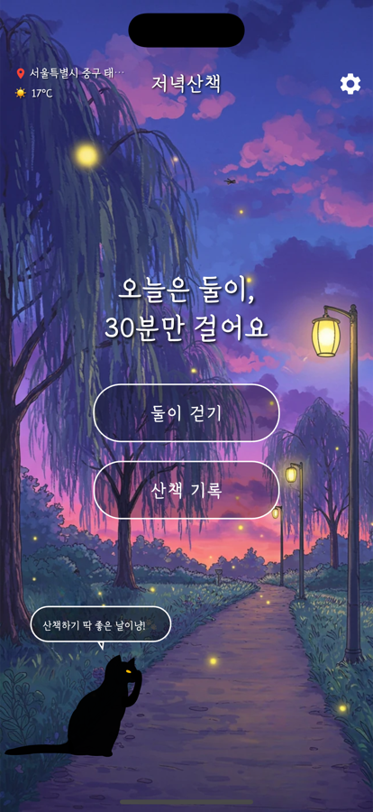
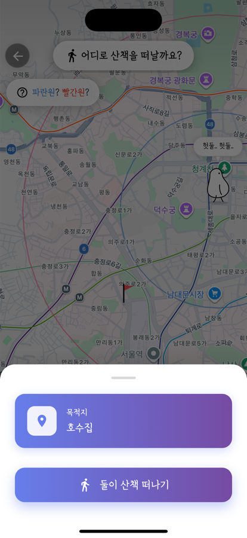
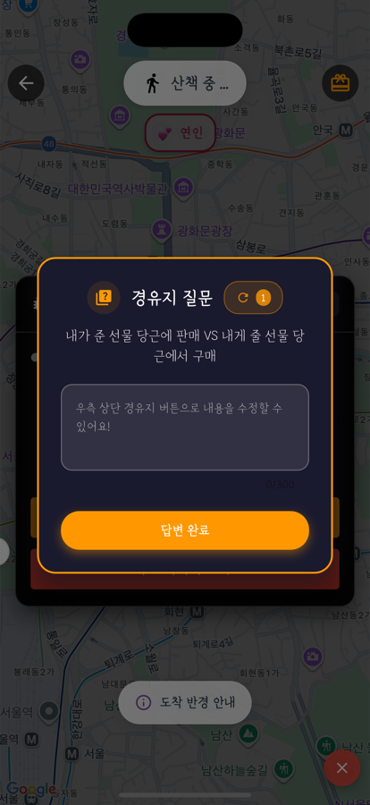
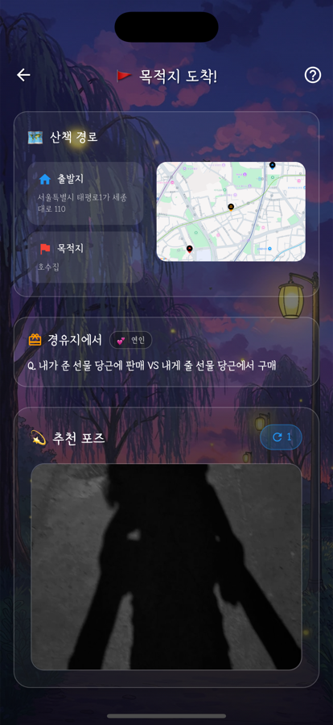

# 🌙 저녁산책

**저녁 식사 후 30분, 산책을 조금 더 재밌게.**

  

&nbsp;
&nbsp;
&nbsp;

 

## 왜 만들었나

저녁을 먹고 나면 식곤증이 와서, 자기 전까지 누워서 폰만 보다가 하루가 끝나곤 했어요.

그걸 끊어 보려고 산책을 나가기 시작했는데, 다녀오면 확실히 머리가 맑아지더라고요. 그래서 산책을 자주 하게 됐는데, 매일 비슷한 길을 걷다 보니 금방 지루해졌습니다.

**"산책 자체를 재밌게 만들면 계속 나가지 않을까?"** 저녁산책은 그 질문에서 시작했어요.

## 어떻게 재밌게 만들었나

| 1. 오늘의 목적지 | 2. 걷는 동안 | 3. 돌아와서 |
|---|---|---|
| 내 주변 지도에서 목적지를 고르고, 누구와 걷는지(혼자 · 연인 · 친구) 정해요. | 경유지에 도착하면 **같이 걷는 사람에 맞는 카드**가 열려요. 혼자면 사색 질문, 연인이면 밸런스 게임, 친구면 미션. | 목적지에서 사진을 찍고, 집에 오면 오늘의 산책이 **카드 한 장**으로 남아요. |

## 만들면서 한 것

- **iOS · Android 동시 출시:** Flutter 하나로 두 스토어에 직접 올렸어요.
- **위치 기반 기능:** 실시간 위치 추적, 경유지 도착 판정, 경로 지도 그리기
- **서버리스 운영:** Firebase(Auth · Firestore · Functions). 외부 API 키는 앱이 아니라 서버(Functions) 쪽에 두었어요.
- **로그인 · 수익화:** Google · Kakao 로그인, AdMob 광고

 

    

---

이 레포는 소개용이에요. 앱 코드는 비공개로 관리합니다. · 만든 사람 [@keepdev0919](https://github.com/keepdev0919)
